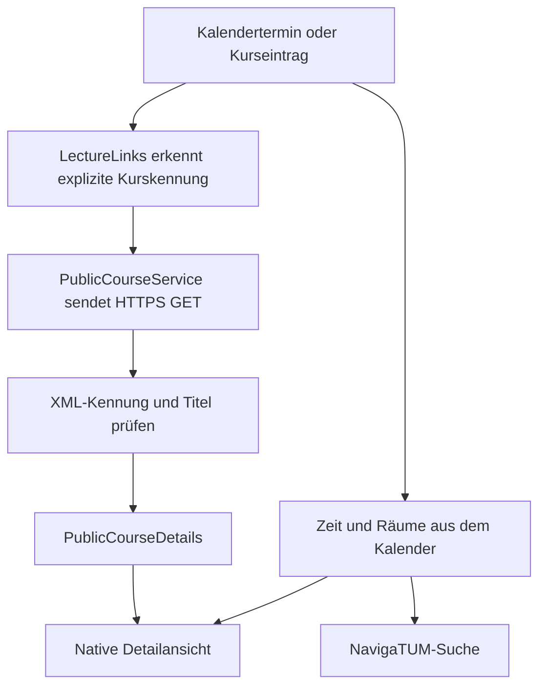

# Lehrveranstaltungsdetails: Fehleranalyse und Datenfluss in V5

[English](lecture-data.en.md) | [简体中文](lecture-data.zh-CN.md) | **Deutsch**

[Repository-Startseite](README.de.md) · [Quellcode und Build](../README_PERSONAL.md)

Nachweise vom **19.–20.10.2026**. Dokumentation veröffentlicht am **21.10.2026**. Beschrieben werden der geprüfte V5-Stand und die damals aufgezeichneten Antworten.

## 1. Warum scheiterte die ursprüngliche App?

Die App verwendete voneinander unabhängige TUMonline-Dienste:

| Zweck | Alter Endpunkt |
| --- | --- |
| Kalender | `wbservicesbasic.kalender` |
| Persönliche Lehrveranstaltungsliste | `wbservicesbasic.veranstaltungenEigene` |
| Lehrveranstaltungsdetails | `wbservicesbasic.veranstaltungenDetails` |

Kalenderdaten konnten deshalb verfügbar sein, obwohl der Detailabruf ausfiel. Der alte Detaildienst antwortete mit **HTTP 200, aber einer XML-Fehlermeldung**, darunter „Veranstaltungsabruf temporär nicht möglich“. Ein erfolgreicher HTTP-Transport bedeutete keine gültige Kursantwort.

Die Berechtigungsansicht prüfte die Dienste durch Datenabrufe. Ein fehlgeschlagener Abruf konnte einen Dienstausfall, einen Netzwerkfehler oder fehlende Berechtigungen bedeuten. Das rote Lectures-Symbol allein bewies daher keine fehlende Freigabe.

Außerdem extrahierte die ursprüngliche App die Nummer mit `split("LvNr=").last`. Nachfolgende Abfrageparameter konnten Bestandteil der Nummer werden; bei fehlendem Parameter konnte sogar die gesamte URL als Nummer übrig bleiben. Das war ein zusätzlicher Clientfehler und nicht die Ursache des universitären Dienstausfalls.

Die Nachweise zeigen den betroffenen Dienst und das Clientverhalten. Sie belegen keine konkrete interne Datenbank-, Deployment- oder Servercode-Ursache der Universität.

Damals herangezogene Quellen: [TUM-Störungsmeldung](https://status.it.tum.de/entry/7294b95e-a666-4f3f-ad56-7dddfdbbfded), Upstream-[Issue #363](https://github.com/TUM-Dev/campus_flutter/issues/363) und [Issue #361](https://github.com/TUM-Dev/campus_flutter/issues/361).

## 2. Warum scheiterten frühere persönliche Versionen weiterhin?

Der frühere persönliche Adapter erkannte moderne Webseitenlinks, aber nicht dieses Kalenderformat:

```text
https://campus.tum.de/tumonline/lv.detail?cLvNr=950944244
```

Er lieferte bereits vor der Detailanfrage eine leere Kurskennung und zeigte „Unable to identify the course from this link“. Diese Regression entstand in der früheren persönlichen Implementierung und ist vom alten Dienstausfall der ursprünglichen App zu unterscheiden.

Das Format ist im Upstream-Modell [Campus-iOS CalendarEvent](https://github.com/TUM-Dev/Campus-iOS/blob/main/Campus-iOS/CalendarComponent/Model/CalendarEvent.swift) dokumentiert. Derselbe Link ergab mit dem ausgelieferten V4- und dem V5-Parser:

| Kalenderparameter | V4 | V5 |
| --- | --- | --- |
| `cLvNr=950944244` | null | `950944244` |
| `cLvNr=950945432` | null | `950945432` |

V5 unterstützt cLvNr am offiziellen Pfad lv.detail und verwendet die Nummer wieder zur Gruppierung von Kalenderterminen. Die alte lv.detail-Webseite antwortete selbst mit 404; Browserlinks werden deshalb auf die aktuelle Desktop-Kursseite umgeschrieben.

## 3. Wie werden die Informationen jetzt geladen?



Die Detailanfrage lautet:

```http
GET https://campus.tum.de/tumonline/ee/rest/slc.tm.cp/student/courses/{courseId}
Accept: application/xml
Accept-Language: en
```

Dies ist der Datenendpunkt der öffentlichen Kurswebseite, **nicht die alte wbservicesbasic-Detail-API**. Während der Prüfung war er ohne persönliches Token lesbar. Ein separater HTTP-Client sendet weder das App-Token noch eine angemeldete Browsersitzung mit.

Unterstützt werden Kalender-cLvNr, explizite pStpSpNr / stp_sp_nr sowie aktuelle Links mit `/slc.tm.cp/student/courses/{id}` oder `/slc.tm.cp/course/{id}`. Relative offizielle Links werden normalisiert. Terminlinks wie `!wbTermin.wbEdit?pTerminNr=...` werden nur per GET gelesen; bevorzugt wird der explizite Kurslink in `a#idLvTitel`. Alte Kursseiten können auch über eindeutige offizielle Weiterleitungen oder einen einzigen eindeutigen Kurslink aufgelöst werden. Es wird kein Bearbeitungsformular abgeschickt und kein Kurs anhand eines vermuteten Titels ausgewählt.

Eine Terminnummer pTerminNr oder eine beliebige alte LvNr ersetzt keine aktuelle Kurskennung. Die XML-Kennung muss zur angefragten Kennung passen. Der zuvor bereitgestellte Termin `893029371` verwies ausdrücklich auf Kurs `950945432`; dieser Zusammenhang wird gelesen, statt die Nummern gleichzusetzen.

## 4. Welche Angaben stammen aus welchen Feldern?

Gelesen werden cpCourseDto und cpCourseDescriptionDto unter cpCourseDetailDto:

| Angezeigte Angabe | XML-Quelle |
| --- | --- |
| Titel | `courseTitle` |
| Lehrveranstaltungsnummer | `courseNumber/courseNumber` |
| Semester | `semesterDto/semesterDesignation` |
| Lehrteam | Namen aus `lectureships/identityLibDto` |
| Zuständige Einrichtung | `organisationResponsibleDto/name` |
| Typ / Sprache | `courseTypeDto` / `courseLanguageDtos` |
| SWS / ECTS | `courseNormConfigs`, Schlüssel `SST` / `ECTS` |
| Inhalte / Lernziele | `courseContent` / `courseObjective` |
| Vorkenntnisse / Lehrmethode | `previousKnowledge` / `teachingMethod` |
| Prüfung / Hinweise | `assessmentScheme` / `additionalInformation` |

Offizielle Übersetzungen werden anhand der App-Sprache ausgewählt. Fehlt eine Übersetzung, bleibt vorhandener offizieller Text erhalten. Eingebettete Auszeichnungen werden in lesbaren Text umgewandelt. Fehlende Angaben werden ausgelassen; SWS werden nicht als ECTS ausgegeben.

**Datum, Uhrzeit und Räume des ausgewählten Termins stammen aus dem Kalender**, nicht aus der öffentlichen Kursbeschreibung. Das Lehrteam einer Veranstaltung bedeutet nicht, dass alle genannten Personen den ausgewählten Termin unterrichten.

Zum Beispiel öffnet `1639, Vortragsraum/Seminarraum (5506.01.639)` die Adresse `https://nav.tum.de/search?q=5506.01.639`. Ohne vollständige Raumkennung wird der ursprüngliche Ortstext gesucht.

## 5. Laden, Fehler und Zwischenspeicherung

Die Ansicht unterscheidet die Zustände Laden, Erfolgreich und Fehlgeschlagen. Bei Fehlern erscheinen nur Fehlermeldung und Wiederholen-Schaltfläche; auch eine fehlgeschlagene Aktualisierung entfernt alte Details. Login-HTML, Fehler-XML und abweichende Kurskennungen gelten nicht als Kursdaten. Kalendertexte wie `fix; Abhaltung;` werden nicht als Lehrinhalt ausgegeben.

Öffentliche Antworten werden sechs Stunden lang je Kurskennung und Sprache im Arbeitsspeicher zwischengespeichert. Wiederholen umgeht diesen Antwortcache. Die Detailansicht fällt nicht auf die alte ausgefallene Detail-API zurück.

## Prüfung und Grenzen

Am **20.10.2026** bestanden 141 Flutter-Tests und die relevante statische Analyse. Auf einem Android-15-Emulator wurden mit der tatsächlichen Ansicht, dem ViewModel und dem HTTP-Adapter zwei Kurse über das Netzwerk geladen:

| ID | Kurs | SWS | ECTS geliefert |
| --- | --- | --- | --- |
| `950944244` | German as a Foreign Language B1.1 | 3 | Nein |
| `950945432` | Hypersonic Flows and Kinetic Theory of Gases | 2 | Nein |

Beide Inhaltsabschnitte wurden durch Scrollen angezeigt. Der Android-Test verwendete konstruierte Kalendertermindaten und echte Kursantworten, keine simulierten HTTP-Antworten und kein persönliches Konto. Die normale Release-APK wurde zusätzlich hinsichtlich Signatur, Installation als Update und Kaltstart geprüft; das Fehlerprotokoll blieb leer. Das physische Telefon und die private Kontoautorisierung des Nutzers wurden durch diese Emulatortests nicht geprüft.

Der Webseitenendpunkt ist keine dokumentierte Entwickler-API mit zugesicherter langfristiger Kompatibilität. Die persönliche Belegungsliste nutzt weiterhin einen anderen alten Dienst. Öffentliche Kursdaten bestätigen keine Belegung und reparieren diesen Dienst nicht. Daher kann seine Berechtigungswarnung bestehen bleiben.

[Prüfprotokolle](validation/) · [Android-Bilder](images/)

## Stellen im Quellcode

- [Linkauswertung](../lib/studiesComponent/service/lecture_links.dart)
- [HTTP-Abruf und Terminauflösung](../lib/studiesComponent/service/public_course_service.dart)
- [XML-Zuordnung](../lib/studiesComponent/model/public_course_details.dart)
- [Zustand und ViewModel](../lib/studiesComponent/viewModel/lecture_details_viewmodel.dart)
- [Native Detailansicht](../lib/studiesComponent/view/lectureDetail/public_course_details_view.dart)
- [Kalender-Testdaten](../test/fixtures/calendar_clvnr.xml)
- [Android-Live-Integrationstest](../integration_test/course_details_live_test.dart)
