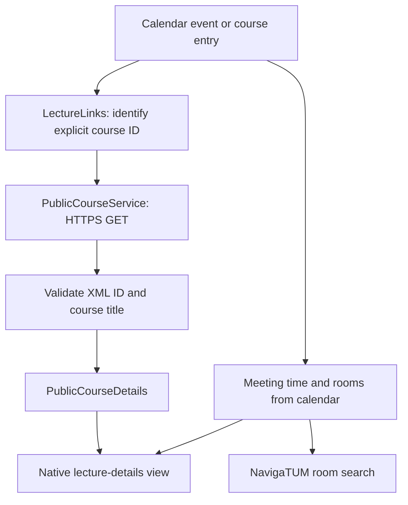

# Lecture details: failure analysis and V5 data flow

**English** | [简体中文](lecture-data.zh-CN.md) | [Deutsch](lecture-data.de.md)

[Repository home](../README.md) · [Source/build notes](../README_PERSONAL.md)

Evidence dates: **2026-10-19–20**. Documentation published: **2026-10-21**. The following describes the tested V5 implementation and recorded responses.

## 1. What failed in the original app?

The app used independent TUMonline services:

| Purpose | Legacy endpoint |
| --- | --- |
| Calendar | `wbservicesbasic.kalender` |
| Personal course list | `wbservicesbasic.veranstaltungenEigene` |
| Lecture details | `wbservicesbasic.veranstaltungenDetails` |

Calendar access could therefore work while lecture details failed. The legacy lecture-details request returned **HTTP 200 with an XML error**, including the message “Veranstaltungsabruf temporär nicht möglich”. A transport-level success was not a successful course response.

The permissions page tested these services by requesting data. A failed request could represent an outage, a network failure or an authorization error. Its red Lectures indicator alone did not establish missing permissions.

The original client also extracted the lecture number using `split("LvNr=").last`. Extra query parameters could become part of the number; a missing parameter could leave the entire URL as the purported ID. This was a separate parsing defect, not the cause of the university's service outage.

The available evidence identifies the affected service and client behavior. It does not reveal the university's internal database, deployment or server-code failure.

Recorded external references: [TUM incident](https://status.it.tum.de/entry/7294b95e-a666-4f3f-ad56-7dddfdbbfded), upstream [issue #363](https://github.com/TUM-Dev/campus_flutter/issues/363) and [issue #361](https://github.com/TUM-Dev/campus_flutter/issues/361).

## 2. Why did earlier personal builds still fail on the phone?

The earlier personal adapter recognized modern website links but missed the calendar format:

```text
https://campus.tum.de/tumonline/lv.detail?cLvNr=950944244
```

It returned a null course ID before issuing the details request, producing “Unable to identify the course from this link”. This regression belongs to the earlier personal implementation; it is distinct from the original app's legacy-service outage.

The calendar format is documented in the upstream [Campus-iOS CalendarEvent model](https://github.com/TUM-Dev/Campus-iOS/blob/main/Campus-iOS/CalendarComponent/Model/CalendarEvent.swift). Running the delivered V4 parser and the V5 parser against the same two links produced:

| Calendar course | V4 result | V5 result |
| --- | --- | --- |
| `cLvNr=950944244` | null | `950944244` |
| `cLvNr=950945432` | null | `950945432` |

V5 accepts `cLvNr` on the official `lv.detail` path and restores its use for calendar course grouping. The old `lv.detail` webpage itself returned 404, so browser navigation is converted to the current desktop course page.

## 3. How are lecture details obtained now?



The course request is:

```http
GET https://campus.tum.de/tumonline/ee/rest/slc.tm.cp/student/courses/{courseId}
Accept: application/xml
Accept-Language: en
```

This is the endpoint used by the public course website, **not the old `wbservicesbasic` details API**. It was readable without a personal token during verification. The adapter uses its own HTTP client and does not send the app's token or borrow a logged-in browser session.

Supported identities include calendar `cLvNr`, explicit `pStpSpNr` / `stp_sp_nr`, and current `/slc.tm.cp/student/courses/{id}` or `/slc.tm.cp/course/{id}` links. Relative official links are normalized. A meeting link such as `!wbTermin.wbEdit?pTerminNr=...` is read with GET; the resolver follows its explicit course anchor, preferably `a#idLvTitel`. Old course pages can also resolve through explicit official redirects or an unambiguous course link. No form is submitted and no course is guessed from its title.

A meeting ID (`pTerminNr`) or arbitrary legacy `LvNr` is not substituted for a current course ID. The returned XML ID must match the requested ID.

The previously supplied meeting `893029371` explicitly linked to course `950945432`. The implementation reads that relationship rather than treating those numbers as interchangeable.

## 4. Which fields are displayed?

The parser reads `cpCourseDetailDto`, then `cpCourseDto` and `cpCourseDescriptionDto`.

| Displayed information | XML source |
| --- | --- |
| Title | `courseTitle` |
| Course number | `courseNumber/courseNumber` |
| Semester | `semesterDto/semesterDesignation` |
| Teaching team | `lectureships/identityLibDto` names |
| Responsible organisation | `organisationResponsibleDto/name` |
| Course type / language | `courseTypeDto` / `courseLanguageDtos` |
| SWS / ECTS | `courseNormConfigs`, keys `SST` / `ECTS` |
| Contents / objectives | `courseContent` / `courseObjective` |
| Prerequisites / method | `previousKnowledge` / `teachingMethod` |
| Assessment / notes | `assessmentScheme` / `additionalInformation` |

Official translations are selected using the app language; available official text is retained if a translation is absent. Embedded markup is converted to readable text. Missing fields are omitted. SWS are never presented as ECTS.

**Meeting dates, times and rooms come from the calendar event**, not from the public course description. The course teaching team is not a claim that every listed person teaches the selected meeting.

Room text such as `1639, Vortragsraum/Seminarraum (5506.01.639)` opens `https://nav.tum.de/search?q=5506.01.639`. Without a full room code, the original location text is searched.

## 5. Loading, errors and caching

The page has mutually exclusive loading, loaded and failed states. Failures show an error and retry button; failed refreshes clear previously displayed details. Login HTML, error XML and mismatched course IDs are not treated as successful course data. Calendar technical text such as `fix; Abhaltung;` is not displayed as a syllabus.

Public responses are cached in memory for six hours per course ID and language; retry bypasses that response cache. The old legacy details API is not used as a fallback by this page.

## Verification and scope

On 2026-10-20, **141 Flutter tests passed**, relevant static analysis passed, and an Android 15 emulator fetched and rendered both courses through the production view, ViewModel and HTTP adapter:

| ID | Course | SWS | ECTS returned |
| --- | --- | --- | --- |
| `950944244` | German as a Foreign Language B1.1 | 3 | No |
| `950945432` | Hypersonic Flows and Kinetic Theory of Gases | 2 | No |

Both teaching-content sections were reached by scrolling. The Android tests used constructed calendar meeting metadata and live course responses, without mocked HTTP responses or a personal account. The normal release APK separately passed signature verification, overwrite installation and cold start; the error log remained empty. The user's physical phone and private account authorization were not exercised by these emulator tests.

The public website endpoint is not a documented long-term developer API contract. The personal enrollment list still uses the separate legacy service; public course details do not establish enrollment or repair that service. This is why the permissions warning may remain.

[Validation records](validation/) · [Android screenshots](images/)

## Implementation map

- [Link parsing](../lib/studiesComponent/service/lecture_links.dart)
- [Public HTTP service and meeting resolution](../lib/studiesComponent/service/public_course_service.dart)
- [XML mapping](../lib/studiesComponent/model/public_course_details.dart)
- [State and ViewModel](../lib/studiesComponent/viewModel/lecture_details_viewmodel.dart)
- [Native details UI](../lib/studiesComponent/view/lectureDetail/public_course_details_view.dart)
- [Calendar regression fixture](../test/fixtures/calendar_clvnr.xml)
- [Android live integration test](../integration_test/course_details_live_test.dart)
