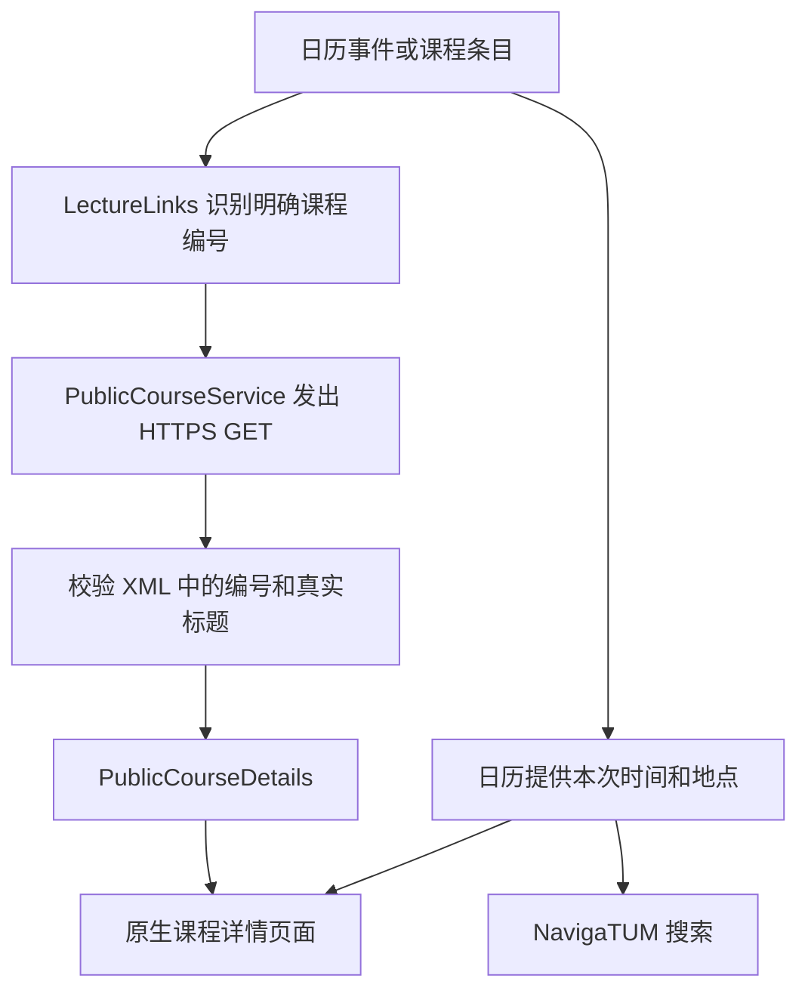

# 课程详情：故障分析与 V5 数据获取流程

[English](lecture-data.en.md) | **简体中文** | [Deutsch](lecture-data.de.md)

[仓库首页](README.zh-CN.md) · [源码与构建说明](../README_PERSONAL.md)

证据日期：**2026-10-19 至 20**。文档上传日期：**2026-10-21**。以下记录已验证的 V5 实现与当时响应。

## 1. 原软件为什么无法查看详情？

原软件分别请求以下 TUMonline 服务：

| 用途 | 旧接口 |
| --- | --- |
| 日历 | `wbservicesbasic.kalender` |
| 个人课程列表 | `wbservicesbasic.veranstaltungenEigene` |
| 课程详情 | `wbservicesbasic.veranstaltungenDetails` |

这些接口彼此独立，因此日历正常不代表课程详情正常。实测旧详情接口返回 **HTTP 200，但 XML 内容是错误**，包含“Veranstaltungsabruf temporär nicht möglich”的服务不可用提示。传输成功不等于取得有效课程数据。

权限页通过实际请求是否成功显示状态。服务停用、网络错误或权限不足都可能导致请求失败，因此 Lectures 的红色标记本身不能证明用户没有授权。

原软件还用 `split("LvNr=").last` 取课程编号：后续查询参数可能混进编号，缺少参数时还可能把整条网址当编号。这是另一个客户端缺陷，不是学校服务器接口停用的原因。

现有证据能定位到失败服务和客户端行为，不能证明学校内部数据库、部署或服务端代码的具体故障。

当时参考：[TUM 故障记录](https://status.it.tum.de/entry/7294b95e-a666-4f3f-ad56-7dddfdbbfded)、上游 [Issue #363](https://github.com/TUM-Dev/campus_flutter/issues/363) 和 [Issue #361](https://github.com/TUM-Dev/campus_flutter/issues/361)。

## 2. 为什么早期个人版在手机上仍然报错？

早期个人版支持新版网页链接，却遗漏日历使用的格式：

```text
https://campus.tum.de/tumonline/lv.detail?cLvNr=950944244
```

因此在请求详情之前，解析器就返回空课程编号，显示“Unable to identify the course from this link”。这是早期个人版的解析回归，必须与原软件遇到的旧服务停用问题区分。

上游 [Campus-iOS CalendarEvent](https://github.com/TUM-Dev/Campus-iOS/blob/main/Campus-iOS/CalendarComponent/Model/CalendarEvent.swift) 保留了该日历格式。将相同链接交给已交付 V4 和 V5 的解析器，结果为：

| 日历课程参数 | V4 | V5 |
| --- | --- | --- |
| `cLvNr=950944244` | null | `950944244` |
| `cLvNr=950945432` | null | `950945432` |

V5 支持官方 `lv.detail` 路径下的 cLvNr，并恢复按课程编号分组。旧 lv.detail 网页本身当时也返回 404，因此浏览器打开课程时会转换到新版桌面课程页面。

## 3. 现在如何获取课程信息？



详情请求：

```http
GET https://campus.tum.de/tumonline/ee/rest/slc.tm.cp/student/courses/{courseId}
Accept: application/xml
Accept-Language: en
```

这是公开课程网页使用的数据端点，**不是旧的 wbservicesbasic 详情接口**。实测时不需要个人 token。适配器使用独立 HTTP 客户端，不发送应用 token，也不借用已登录浏览器会话。

支持日历 cLvNr、明确的 pStpSpNr / stp_sp_nr，以及新版 `/slc.tm.cp/student/courses/{id}`、`/slc.tm.cp/course/{id}` 链接；可规范化官方相对链接。对于 `!wbTermin.wbEdit?pTerminNr=...` 日程链接，采用只读 GET，优先读取 `a#idLvTitel` 中明确的课程链接。旧课程页也可通过官方明确重定向或唯一课程链接解析。不会提交编辑表单，也不通过课程名称猜测匹配。

日程编号 pTerminNr 和任意旧 LvNr 不会直接替代新课程编号；响应 XML 的 ID 必须与请求一致。此前提供的日程 `893029371` 明确指向课程 `950945432`，代码读取这个关联，而不是认为两个数字可以互换。

## 4. 显示哪些字段，来自哪里？

解析 `cpCourseDetailDto` 下的 `cpCourseDto` 和 `cpCourseDescriptionDto`：

| 信息 | XML 来源 |
| --- | --- |
| 标题 | `courseTitle` |
| 课程号 | `courseNumber/courseNumber` |
| 学期 | `semesterDto/semesterDesignation` |
| 教学团队 | `lectureships/identityLibDto` 姓名 |
| 负责单位 | `organisationResponsibleDto/name` |
| 类型、语言 | `courseTypeDto`、`courseLanguageDtos` |
| SWS、ECTS | `courseNormConfigs` 的 `SST`、`ECTS` |
| 内容、目标 | `courseContent`、`courseObjective` |
| 先修、教学方式 | `previousKnowledge`、`teachingMethod` |
| 考核、备注 | `assessmentScheme`、`additionalInformation` |

优先选择应用语言对应的官方译文；缺少译文时保留实际存在的官方文字，处理内嵌标记形成可读文本。缺失字段不显示，SWS 不冒充 ECTS。

**本次上课日期、时间和教室来自日历事件**，不来自公开课程介绍。教学团队是整门课的人员列表，不代表所有人都给这一次课授课。

例如 `1639, Vortragsraum/Seminarraum (5506.01.639)` 会打开 `https://nav.tum.de/search?q=5506.01.639`；没有完整房间编码时搜索原始地点文字。

## 5. 页面状态、错误与缓存

页面的加载、成功、失败状态互斥。失败时仅显示错误和重试；刷新失败也清除旧详情。登录 HTML、错误 XML 或编号不符的课程不会当成成功。`fix; Abhaltung;` 等日历技术文字不会充当教学内容。

公开响应按课程 ID 和语言在内存缓存六小时；重试绕过课程响应缓存。该详情页不再回退到已停用的旧详情接口。

## 验证与边界

**2026-10-20**：141 项 Flutter 测试通过，相关静态检查通过。Android 15 模拟器使用实际页面、ViewModel 和 HTTP 适配器联网读取：

| ID | 课程 | SWS | 是否返回 ECTS |
| --- | --- | --- | --- |
| `950944244` | German as a Foreign Language B1.1 | 3 | 否 |
| `950945432` | Hypersonic Flows and Kinetic Theory of Gases | 2 | 否 |

两门课均通过滚动显示教学内容。Android 测试使用构造的日历会议元数据和实时课程响应，没有 mock HTTP 响应，也未使用个人账号。正常发布 APK 另行通过签名、覆盖安装和冷启动检查，错误日志为空。模拟器测试未执行用户实体手机与私人账号授权。

网页数据端点不是已确认有长期兼容承诺的开发者 API。私人课程列表仍使用另一套旧服务；公开详情可读不能证明选课成功，也不能修复该旧服务。这也是权限页仍可能保留提示的原因。

[验证记录](validation/) · [Android 截图](images/)

## 源码位置

- [链接解析](../lib/studiesComponent/service/lecture_links.dart)
- [HTTP 获取与日程映射](../lib/studiesComponent/service/public_course_service.dart)
- [XML 字段映射](../lib/studiesComponent/model/public_course_details.dart)
- [状态与 ViewModel](../lib/studiesComponent/viewModel/lecture_details_viewmodel.dart)
- [原生详情 UI](../lib/studiesComponent/view/lectureDetail/public_course_details_view.dart)
- [日历回归样例](../test/fixtures/calendar_clvnr.xml)
- [Android 实时集成测试](../integration_test/course_details_live_test.dart)
